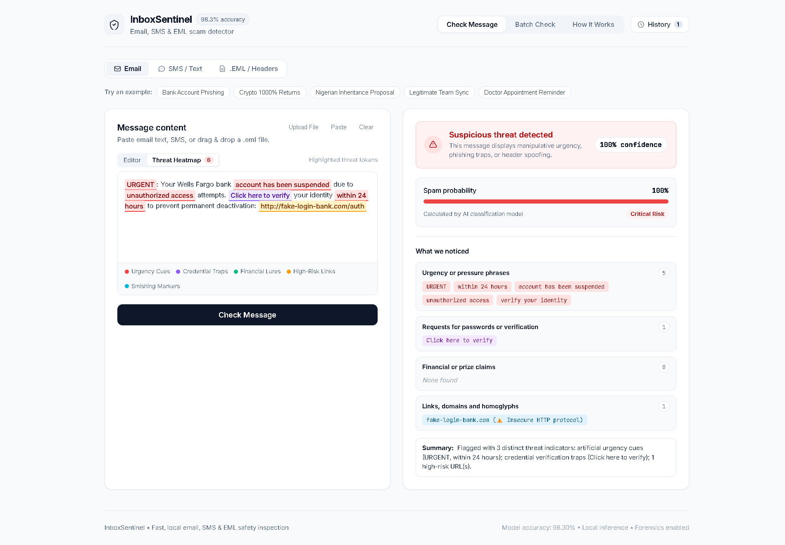
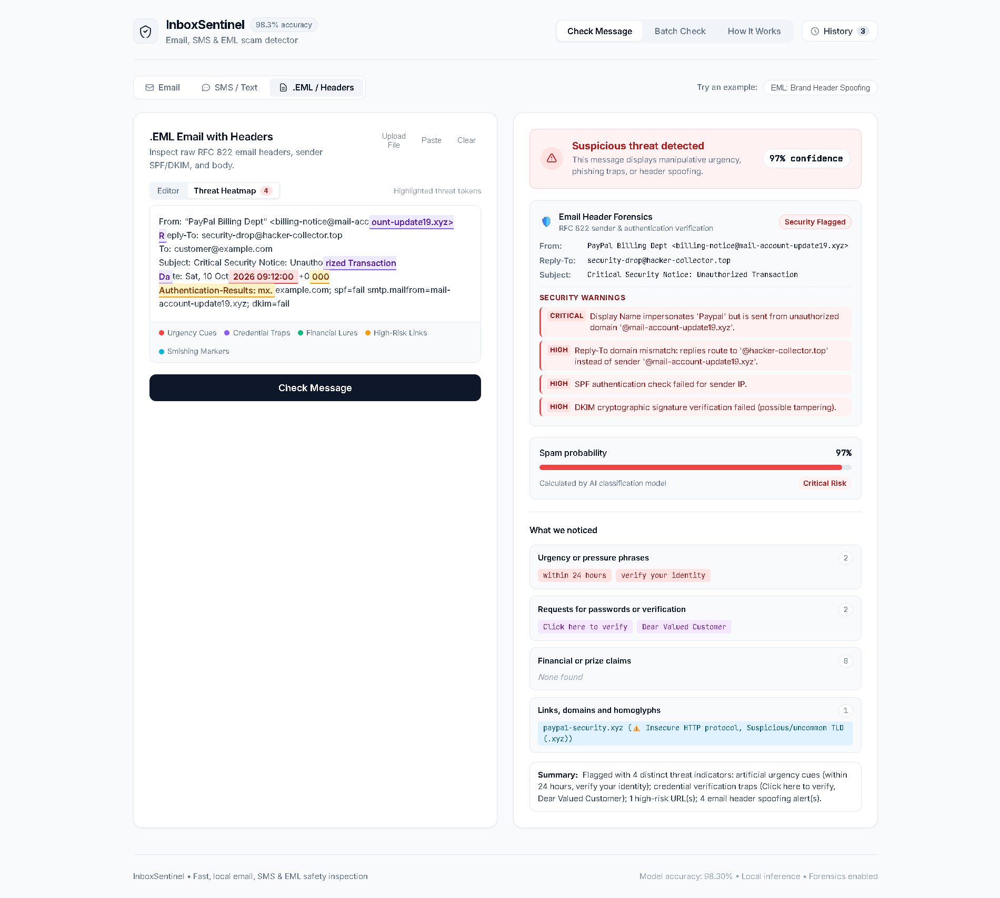
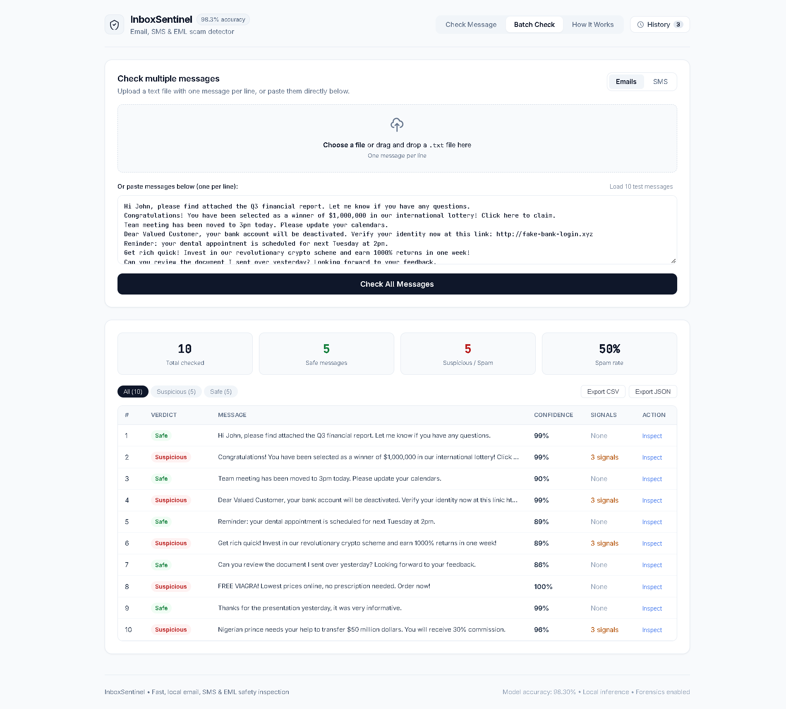
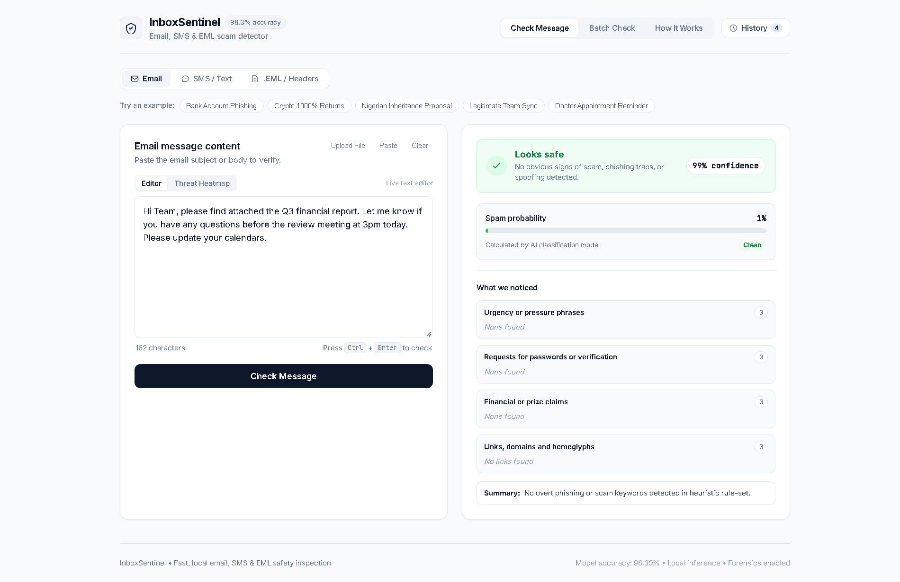
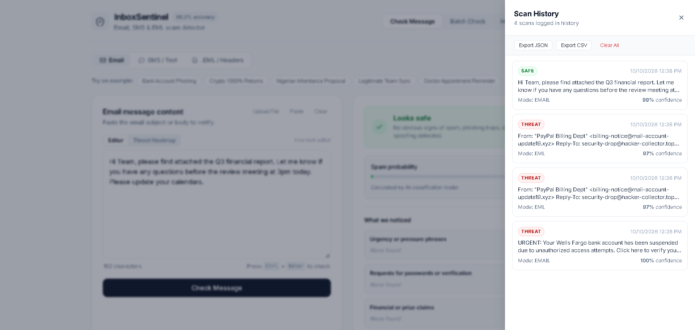

# 🛡️ InboxSentinel — AI-Powered Email, SMS & EML Threat Detection

[](https://github.com/jayantshringi/InboxSentinel/actions)
[](https://github.com/jayantshringi/InboxSentinel)
[](https://python.org)
[](https://github.com/jayantshringi/InboxSentinel)
[](LICENSE)

An intelligent, privacy-first cybersecurity inspection engine that classifies messages as **Safe** or **Spam / Phishing / Smishing** using Machine Learning combined with natural language heuristics and deep RFC 822 email header forensics.

---

## 📸 Interface & Capabilities

### 1. Interactive Threat Heatmap
Real-time visual token highlighter spotlighting urgency markers, credential traps, financial lures, and suspicious links directly in the message text.


### 2. RFC 822 `.EML` Header Forensics & Brand Spoofing Audit
Parses raw `.eml` email headers to detect brand display-name impersonation (e.g. sender claiming to be PayPal from an unauthorized domain), Reply-To diversion traps, and SPF/DKIM verification checks.


### 3. Enterprise Batch Scanner with Real-Time KPIs
Scan dozens or hundreds of emails and SMS messages simultaneously with 4 KPI summary cards, filter pills, and instant CSV/JSON report exports.


### 4. Zero False-Positive Safe Email Inspection
Accurately identifies legitimate communication with 99%+ confidence, clear indicators, and detailed explanation summaries.


### 5. Local Session Audit Trail & History Drawer
Slide-out history drawer storing recent scans locally with timestamps, classification pills, confidence scores, and one-click JSON/CSV exports.


---

## ⚡ Key Features

- **High-Accuracy ML Model**: Trained on **164,970 real-world emails and SMS messages** across reputable security datasets with **98.30% test accuracy** and **99.83% ROC-AUC**.
- **RFC 822 `.EML` Forensics**: Deep email header inspection detecting:
  - Display-name brand impersonation across popular targets (PayPal, Wells Fargo, Apple, Google, Microsoft, Amazon, Netflix, Chase, etc.).
  - Reply-To domain routing mismatches.
  - SPF & DKIM authentication validation flags.
- **Explainable Threat Heatmap**: Token-level in-browser color highlights for:
  - 🚨 **Urgency Cues**: "urgent", "suspended", "action required within 24 hours".
  - 🔑 **Credential Traps**: "verify your identity", "reset password", "login now".
  - 💰 **Financial Lures**: "wire transfer", "inheritance", "cryptocurrency investment".
  - 🔗 **High-Risk Links**: Insecure HTTP protocols, uncommon TLDs (`.xyz`, `.top`, `.tk`), and numeric IP hostnames.
- **Homoglyph & Typosquatting Engine**: Identifies Unicode confusable character attacks (e.g. Cyrillic lookalikes), Punycode strings (`xn--`), and brand domain permutations.
- **100% Privacy & Zero-Cloud Local Inference**: No message body or sensitive email data ever leaves your device. All inference and heuristic rules execute locally.
- **High-Throughput Batch Processing**: Process entire text files or paste lists of emails/SMS with real-time analytics.
- **Modern, Dependency-Free Cyber Web UI**: Built with pure vanilla HTML5, CSS3, and JavaScript — zero heavy node_modules or front-end build pipelines required.
- **Full CLI Suite**: Automation-ready command-line tool with human-readable and structured `--json` output.

---

## 🚀 Quick Start

### 1. Installation

Clone the repository and install the lightweight Python dependencies:

```bash
git clone https://github.com/jayantshringi/InboxSentinel.git
cd InboxSentinel
pip install -r requirements.txt
```

### 2. Launch the Web Interface

Start the local server:

```bash
python src/web_server.py --port 8000
```

Open your browser and navigate to **[http://127.0.0.1:8000](http://127.0.0.1:8000)**.

### 3. Command Line Usage (CLI)

InboxSentinel provides a full-featured CLI interface for scripts and terminals:

```bash
# Scan a plain text email
python src/scan_email.py --text "URGENT: Your account has been suspended. Verify now: http://fake-bank-login.xyz"

# Scan an RFC 822 (.eml) email file with header forensics
python src/scan_email.py --eml path/to/suspicious_email.eml

# Scan an SMS / Text message
python src/scan_email.py --sms "Claim your free prize now at http://win-claim.top"

# Batch scan a file containing one message per line
python src/scan_email.py --batch tests/test_emails.txt

# Return raw JSON for pipeline integration
python src/scan_email.py --text "Project sync meeting moved to 3pm" --json
```

---

## 📊 Model Performance & Benchmarks

The core machine learning pipeline combines an optimized **TF-IDF Vectorizer** (unigrams + bigrams, sublinear TF scaling) with an L2-regularized **Logistic Regression** classifier trained on a deduplicated corpus of **164,970 samples**:

| Metric | Score | Description |
|---|---|---|
| **Accuracy** | **98.30%** | Overall correct classifications on unseen test set |
| **Precision** | **98.09%** | Accuracy of positive threat detections (ultra-low false positive rate) |
| **Recall** | **98.65%** | Percentage of genuine threats caught |
| **F1-Score** | **98.37%** | Harmonic mean of precision and recall |
| **ROC-AUC** | **99.83%** | Discriminative threshold ability |
| **Inference Latency** | **< 15 ms** | Real-time classification on standard CPU |
| **Model Size** | **~25 MB** | Lightweight, deployable on resource-constrained devices |

### Datasets Utilized
- **Enron Email Dataset** (Legitimate corporate communication)
- **SpamAssassin Public Corpus** (Spam and Ham reference sets)
- **CEAS 2008 & Nazario Datasets** (Targeted phishing & spear-phishing)
- **Nigerian Fraud Corpus** (Advance-fee fraud & social engineering)
- **SMS Spam Collection & Smishing Corpus** (~15,500 mobile SMS & smishing records)

---

## 🛠️ REST API Reference

InboxSentinel includes a lightweight built-in HTTP server exposing REST endpoints:

### `POST /api/scan`
Inspect a single message or `.eml` raw text.

**Request:**
```json
{
  "text": "From: \"PayPal Support\" <security@mail-update.xyz>\nSubject: Urgent\n\nPlease verify your account: http://paypa1-login.xyz",
  "mode": "eml"
}
```

**Response:**
```json
{
  "is_threat": true,
  "confidence": 98.4,
  "spam_probability": 98.4,
  "verdict": "Suspicious / Phishing",
  "header_info": {
    "from_raw": "PayPal Support <security@mail-update.xyz>",
    "subject": "Urgent"
  },
  "header_alerts": [
    {
      "severity": "CRITICAL",
      "rule": "brand_display_impersonation",
      "message": "Display Name impersonates 'Paypal' but is sent from unauthorized domain '@mail-update.xyz'."
    }
  ],
  "indicators": {
    "risk_level": "CRITICAL",
    "urgency_triggers": ["urgent"],
    "credential_triggers": ["verify your account"],
    "urls": [{"url": "http://paypa1-login.xyz", "flags": ["Insecure HTTP protocol", "Suspicious/uncommon TLD (.xyz)"]}]
  },
  "highlight_spans": [...]
}
```

### `POST /api/batch`
Analyze an array of messages in a single request.

### `GET /api/presets`
Returns curated test sample messages (Phishing, Spoofing, Smishing, Legitimate Ham).

### `GET /api/stats`
Returns system performance and model training metrics.

---

## 🧪 Testing & Quality Assurance

InboxSentinel includes a comprehensive test suite covering ML inference, heuristics, EML parsing, and API endpoints:

```bash
# Run RFC 822 header forensics & homoglyph unit tests
python tests/test_forensics.py

# Run web server and REST API integration tests
python tests/test_ui_server.py

# Run full evaluation against the test dataset
python scripts/validate_model.py
```

---

## 📁 Repository Structure

```
InboxSentinel/
├── .github/workflows/ci.yml    # GitHub Actions automated CI testing workflow
├── Screenshot/                 # High-resolution screenshots for documentation & social
├── src/
│   ├── scan_email.py           # CLI tool & file ingestion engine
│   ├── threat_analyzer.py      # Forensics, brand impersonation, homoglyphs & spans
│   ├── web_server.py           # Multi-threaded REST API & static server
│   └── ui/                     # Web Application
│       ├── index.html          # Responsive HTML5 layout with Heatmap & Drawer
│       ├── style.css           # Modern Cyber design system
│       ├── app.js              # Client-side state, heatmap highlighter & storage
│       └── favicon.svg         # Security shield icon
├── scripts/
│   ├── explore_data.py         # Dataset inspection and statistics
│   ├── preprocess_data.py      # Ingestion, cleaning and deduplication
│   ├── train_model.py          # TF-IDF + Logistic Regression training pipeline
│   └── validate_model.py       # Comprehensive validation and metrics generator
├── tests/
│   ├── test_emails.txt         # Sample batch email dataset
│   ├── test_sms.txt            # Sample batch SMS dataset
│   ├── test_forensics.py       # Forensics & brand spoofing test suite
│   └── test_ui_server.py       # REST API integration test suite
├── models/
│   ├── spam_detector.pkl       # Trained classification model
│   ├── tfidf_vectorizer.pkl    # Serialized TF-IDF feature extractor
│   └── model_metadata.json     # Architecture parameters & test metrics
├── requirements.txt            # Python dependencies
└── README.md                   # Documentation & setup guide
```

---

## 🔒 Privacy & Security Guarantee

InboxSentinel is designed with a strict **Local-First Architecture**:
1. **No External Network Calls**: Message bodies, sender headers, and attachments are processed strictly on localhost.
2. **No Data Logging**: Emails and SMS messages are never written to external databases or analytics providers.
3. **Session-Only Storage**: Web UI history is stored entirely in your browser's `localStorage` and can be cleared in one click.

---

## 📄 License

This project is licensed under the MIT License — see the [LICENSE](LICENSE) file for details.
